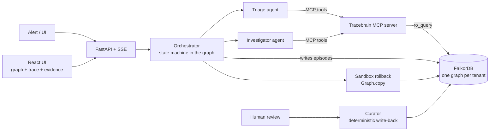
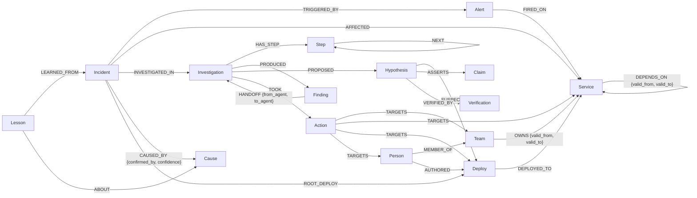

# Tracebrain

**Evidence-backed root-cause analysis across time, on a FalkorDB temporal graph.**

When an incident fires, Tracebrain rebuilds the service dependency graph *as it was at that moment*. Two agents then find the deploy that most likely caused it. Every claim they make must cite graph edges they actually retrieved, or it is rejected. The system only learns from outcomes an engineer has confirmed.

> **Graph Hacks: Context for AI Agents** (WeMakeDevs × FalkorDB, Oct 15–18 2026)
> **Tracks entered:** Track 01, *Agents That Act on Connected Data* · Track 02, *Agent Memory and Coordination*
> **Demo video:** _add link_ · **Run it:** [local setup](#setup) (about 5 minutes)

---

## What it does

1. An alert becomes an `Incident` node.
2. The **Triage agent** calls graph tools over MCP. It finds the blast radius and the owners as of incident time, then writes them as `Finding` nodes on a blackboard in the graph and hands off with a `HANDOFF` edge.
3. The **Investigator agent** reads the findings, recalls confirmed lessons, and asks for ranked **suspect deploys**. These are deploys on the alerted service or anything it depends on (up to 3 hops) *at incident time*, scored by an explicit formula. It submits hypotheses whose claims cite edge ids.
4. An **evidence gate** checks every cited edge. It must have been returned by a tool in this investigation, must exist, and must be about what the claim says. Failing claims are bounced back to the agent to fix.
5. The agent proposes **actions** (ticket the owning team, rollback proposal, page an owner) as `Action` nodes linked to their targets.
6. The rollback is **tried in a sandbox copy of the graph**: the deploy is marked rolled back and the suspects are re-ranked to show what would be blamed next.
7. A **human reviews**. Confirm writes `Cause` and `Lesson` nodes; reject weakens them and can retract them. Next time the same symptom fires on that service, the lesson boosts the right suspect.

Everything (the world, every tool call, the agent blackboard, hypotheses, claims, actions and memory) lives in FalkorDB, one graph per tenant. Kill the server mid-investigation and `POST …/resume` continues from the graph. Completed tool calls are replayed from `Step` nodes, not re-run.

## Results

From `uv run python eval/run.py`. It is deterministic, makes no LLM calls, and its output is in [`eval/results.json`](eval/results.json). It measures the suspect ranking the Investigator receives across 52 synthetic incidents in 2 tenants: 48 with a culprit deploy and 4 where no deploy is at fault. **MRR** (mean reciprocal rank) is higher when the culprit sits closer to the top.

| Method (48 incidents with a culprit) | Top-1 | Top-3 | MRR | Culprit not ranked at all |
|---|---|---|---|---|
| Latest deploy anywhere (no graph) | 7 | 44 | 0.50 | 0 |
| Latest deploy on the alerted service (no graph) | 13 | 24 | 0.39 | 24 |
| Largest change in window (no graph) | 4 | 23 | 0.35 | 0 |
| Graph, **time-blind** (ignores `valid_from/valid_to`) | 19 | 44 | 0.64 | 0 |
| **Graph, as-of** (the real tool, memory off) | **22** | **47** | **0.69** | 0 |
| **Graph, as-of + memory** (lessons from earlier confirmed incidents) | **30** | **48** | **0.80** | 0 |

- **Memory:** on repeat incidents (36), top-1 goes from **17 → 25** and MRR from 0.70 → 0.83.
- **Time-awareness:**
  - A time-blind graph ranks the culprit *lower* in **10/48** incidents, and never higher.
  - It puts a deploy on a no-longer-called (or not-yet-called) service first in 5 incidents.
  - It returns the wrong owning team in **8** incidents (an ownership transfer).
  - Example: in `payments/inc:007` the as-of graph ranks the culprit #1, while the time-blind graph ranks `currency-v2` first, which `checkout` doesn't call until day 24.
- **Narrowing:** about 4.9 deploys sit in each 24h window, and the as-of graph keeps 3.1 while never missing the culprit.
- **Abstention:** all 4 no-deploy incidents get an empty suspect list, so the agent abstains instead of guessing.

Honest limits: blast radius never differs between as-of and time-blind in this dataset, and the graph is small (12 services). See [Limitations](#limitations).

## Architecture



- **Agents** use Groq's free tier (`openai/gpt-oss-120b`) through an OpenAI-compatible API. Each agent has a tool allowlist.
- **Tenant isolation:** tenant and incident time are sent as **MCP request metadata**, never as tool arguments, so the LLM can neither see nor change them (`tracebrain/tools/mcp_server.py`).
- **Read-only agents:** every agent read goes through FalkorDB `ro_query`, so agents cannot write to the world graph. Their only write is `write_finding` on their own investigation.

## Graph data model



| Layer | Nodes | Written by |
|---|---|---|
| World (temporal) | Service, Team, Person, Deploy, Alert, Incident | ingestion (`tracebrain/ingest.py`, idempotent `MERGE`) |
| Episodic memory + blackboard | Investigation, Step, Finding, Hypothesis, Claim, Action, Verification | orchestrator; agents only via `write_finding` |
| Semantic memory | Cause (`aliases`, `confidence`, `retracted`) | curator, after a human confirm/reject |
| Procedural memory | Lesson (`symptom`, `service`, `check_first`, `success_count`, `fail_count`, `retracted`) | curator, after a human confirm/reject |

**Time** is epoch seconds. A temporal edge is live at `t` when `valid_from <= t < valid_to`. Open-ended edges use `valid_to = 4102444800` (year 2100), so hot queries never test for null.

## Queries the product depends on

All Cypher lives in [`tracebrain/queries.py`](tracebrain/queries.py) as named constants (about 55 statements). These are the ones that do the reasoning.

**Blast radius as of incident time.** Multi-hop, with every edge on the path valid at `t`:
```cypher
MATCH p = (up:Service)-[:DEPENDS_ON*1..5]->(f:Service {name: $svc})
WHERE all(r IN relationships(p) WHERE r.valid_from <= $t AND r.valid_to > $t)
WITH up, p, length(p) AS len ORDER BY len
WITH up, collect(p)[0] AS path, min(len) AS hops
RETURN up.name AS service, hops, [r IN relationships(path) | id(r)] AS edge_ids
ORDER BY hops, service
```

**Suspect deploys.** As-of dependency closure (0–3 hops), then deploys in the look-back window, then the author. The returned `edge_ids` *are* the evidence trail the agent must cite:
```cypher
MATCH p = (f:Service {name: $svc})-[:DEPENDS_ON*0..3]->(s:Service)
WHERE all(r IN relationships(p) WHERE r.valid_from <= $t AND r.valid_to > $t)
WITH s, p, length(p) AS len ORDER BY len
WITH s, collect(p)[0] AS path, min(len) AS proximity
MATCH (d:Deploy)-[dr:DEPLOYED_TO]->(s)
WHERE d.ts <= $t AND d.ts >= $t - $window AND NOT coalesce(d.rolled_back, false)
OPTIONAL MATCH (a:Person)-[:AUTHORED]->(d)
RETURN d.id AS deploy, s.name AS service, s.service_type AS service_type, d.ts AS ts,
       d.change_size AS change_size, d.kind AS kind, d.summary AS summary, a.handle AS author,
       proximity, [r IN relationships(path) | id(r)] + [id(dr)] AS edge_ids
ORDER BY proximity, ts DESC
```
Suspects are then scored in Python with explicit, inspectable features: `proximity`, `recency`, `change_size`, `fail_rate`, `centrality` (PageRank) and `lesson_match` (memory). See `tracebrain/scoring.py`.

**Owners as of incident time:**
```cypher
MATCH (t:Team)-[r:OWNS]->(s:Service)
WHERE s.name IN $services AND r.valid_from <= $t AND r.valid_to > $t
OPTIONAL MATCH (p:Person)-[:MEMBER_OF]->(t)
RETURN s.name AS service, t.name AS team, collect(p.handle) AS people, id(r) AS edge_id
```

**Shortest dependency path as of `t`.** FalkorDB's `shortestPath()` ignores edge properties (see below), so this uses var-length + filter + `LIMIT 1`:
```cypher
MATCH p = (a:Service {name: $a})-[:DEPENDS_ON*1..6]->(b:Service {name: $b})
WHERE all(r IN relationships(p) WHERE r.valid_from <= $t AND r.valid_to > $t)
WITH p, length(p) AS len ORDER BY len LIMIT 1
RETURN [n IN nodes(p) | n.name] AS services, [r IN relationships(p) | id(r)] AS edge_ids
```

**Graph algorithms** (structural priors; FalkorDB's `algo.*` don't filter on edge properties, so they are time-agnostic):
```cypher
CALL algo.pageRank('Service', 'DEPENDS_ON') YIELD node, score RETURN node.name AS service, score
CALL algo.betweenness({nodeLabels: ['Service'], relationshipTypes: ['DEPENDS_ON']}) YIELD node, score RETURN node.name, score
```

**Evidence gate.** Resolve the cited edge ids to `(type, src, dst)` and check them against the claim:
```cypher
MATCH (a)-[r]->(b) WHERE id(r) IN $ids
RETURN id(r) AS id, type(r) AS type, coalesce(a.name, a.handle, a.id) AS src, coalesce(b.name, b.handle, b.id) AS dst
```

**Memory recall.** Lessons and confirmed precedents, strictly from *before* the incident:
```cypher
MATCH (l:Lesson {symptom: $symptom, service: $service})-[:LEARNED_FROM]->(i:Incident)
WHERE NOT l.retracted AND i.ts < $t
WITH l, collect(i.id) AS evidence
OPTIONAL MATCH (l)-[:ABOUT]->(c:Cause)
RETURN l.id AS id, l.check_first AS check_first, l.success_count AS success_count, l.fail_count AS fail_count, c.name AS cause, evidence
ORDER BY success_count - fail_count DESC LIMIT 5
```
```cypher
// RECALL_SIMILAR, abbreviated (full version in queries.py)
MATCH (i:Incident)-[cb:CAUSED_BY]->(c:Cause)
WHERE i.ts < $t AND i.symptom = $symptom AND NOT c.retracted
MATCH (i)-[:AFFECTED]->(s:Service)
OPTIONAL MATCH (i)-[:ROOT_DEPLOY]->(d:Deploy)-[:DEPLOYED_TO]->(ds:Service)
RETURN i.id AS incident, s.name AS service, c.name AS cause, ds.name AS culprit_service, d.kind AS culprit_kind
```

**Agent handoff on the blackboard:**
```cypher
MATCH (v:Investigation {id: $id})-[:PRODUCED]->(f:Finding {agent: $from_agent})
CREATE (f)-[:HANDOFF {from_agent: $from_agent, to_agent: $to_agent, ts: $now}]->(v)
```

### FalkorDB findings that shaped the design

These were checked against a running server by [`scripts/capability_check.py`](scripts/capability_check.py); full output is in [`docs/falkordb_capabilities.md`](docs/falkordb_capabilities.md).
- `shortestPath()` is only allowed in `WITH`/`RETURN`, and it **ignores edge properties**. At t=50 it returned a path through a dependency that didn't exist yet. So all time-critical paths use var-length + an `all()` as-of filter.
- `algo.pageRank`, `algo.betweenness`, `algo.BFS`, `algo.WCC` and `algo.labelPropagation` all work, but none filter on edge properties. They are used only as time-agnostic priors.
- `ro_query` rejects writes, which gives free enforcement that agents can only read.
- `Graph.copy()` provides a cheap sandbox for "what if we roll this back".

## MCP tools

The server is `tracebrain/tools/mcp_server.py`. It runs over stdio, or streamable HTTP with `--http`, and also works from any MCP client.

| Tool | Graph work | Agent |
|---|---|---|
| `blast_radius` | as-of multi-hop `DEPENDS_ON*1..5` | Triage |
| `owners_of` | as-of `OWNS` + `MEMBER_OF` | Triage, Investigator |
| `suspects` | as-of closure → deploys → authors, PageRank, lessons | Investigator |
| `path_between` | as-of shortest path | Investigator |
| `centrality` | `algo.pageRank`, `algo.betweenness` | Investigator |
| `write_finding` / `read_findings` | blackboard nodes | Triage / Investigator |
| `recall_similar`, `recall_lessons`, `get_past_investigation` | memory subgraph | both |
| `get_incident` | incident lookup | external clients |

## Setup

Prerequisites: Docker, [uv](https://docs.astral.sh/uv/), Node 20+, and a free [Groq API key](https://console.groq.com/keys). The key is only needed for live agent runs; tests and the eval need none.

```bash
git clone https://github.com/abhishekkamble12/Tracebrain.git && cd Tracebrain
cp .env.example .env                     # add GROQ_API_KEY; set FALKOR_PORT if 6379 is taken
docker compose up -d                     # FalkorDB on :6379, FalkorDB Browser on :3000
uv sync
uv run python -m tracebrain.seed --reset # 2 tenants (payments, platform), 52 incidents
uv run uvicorn tracebrain.api.main:app --port 8000   # API docs at http://localhost:8000/docs

cd ui && npm install && npm run dev      # http://localhost:5173 (set TRACEBRAIN_API_URL if the API isn't on :8000)
```

If port 6379 or 3000 is already in use (for example by another Redis), set `FALKOR_PORT` / `FALKOR_BROWSER_PORT` in `.env`: `docker-compose.yml` publishes FalkorDB on those ports and the app connects to the same `FALKOR_PORT`. Pointing Tracebrain at a plain Redis fails with a clear "without the FalkorDB graph module" message.

**Windows (PowerShell).** `&&`, `export` and `VAR=value cmd` are bash syntax and fail in Windows PowerShell. Use the launcher, which starts FalkorDB, seeds if needed, and opens the API (:8010) and UI (:5180) in their own windows:
```powershell
copy .env.example .env      # then add GROQ_API_KEY; set FALKOR_PORT if 6379 is taken
uv sync
powershell -ExecutionPolicy Bypass -File scripts
un-local.ps1          # -Reset for fresh data and empty memory
```
Or by hand, one command per line:
```powershell
docker compose up -d
uv run python -m tracebrain.seed --reset
uv run uvicorn tracebrain.api.main:app --port 8010                      # terminal 1
cd ui; $env:TRACEBRAIN_API_URL = "http://localhost:8010"; npx vite --port 5180   # terminal 2
```

Other entry points:
```bash
uv run pytest -q                                      # 60 tests (FalkorDB-backed ones skip if it isn't running)
uv run python eval/run.py                             # writes eval/results.json (no LLM calls)
uv run python -m tracebrain.agents.smoke --tenant payments --incident inc:001   # one live run in the terminal
uv run python -m tracebrain.tools.mcp_server --http   # MCP server on :8765/mcp for other clients
```

Demo path in the UI:
1. Open `payments` and run `inc:001`. The culprit is a config change on `redis-cart`, two hops away, competing with newer decoys.
2. Confirm it in the review box.
3. Run `inc:007` (same symptom, later) with memory on. `recall_similar` surfaces `inc:001` as a confirmed precedent and the `redis-cart` suspect gets a `lesson_match` boost. Note the stale decoy `dep:0056` on `currency-v2`: it was deployed 105 min before the alert, but `checkout` doesn't call `currency-v2` until day 24, so the as-of graph never offers it. A time-blind graph ranks it first.
4. Run `inc:025`. Nothing deployed on its dependencies, so the agent abstains.

## Data

All data is **synthetic** and generated by a seeded, deterministic generator ([`tracebrain/connectors/synthetic.py`](tracebrain/connectors/synthetic.py)). It is an Online Boutique-shaped system with 12 services and 18 dependency edges, and it includes:
- 3 timeline changes: a `currency` → `currency-v2` migration, an ownership transfer, and a new dependency.
- About 230 deploys per tenant.
- 26 incidents per tenant, each with an injected culprit and decoys: newer deploys on callers, deploys elsewhere on the dependency path, and *stale* deploys on dependencies that aren't live at incident time.

The ground truth is written to `data/ground_truth.json`. Agents never read it. `leakage_violations()` checks that no agent-visible text hints at the cause. Names are fictional handles. No private or personal data is used.

## Limitations

- **The rollback "symptom check" is an oracle.** The sandbox part is real graph work: `Graph.copy`, mark rolled back, re-rank. But whether the symptom *clears* is answered from the synthetic ground truth, and is labelled `simulated oracle` everywhere it appears. A real deployment would revert in staging and watch metrics. The check never re-ranks hypotheses and is not part of the eval.
- **Synthetic, small graph.** Blast radius never differs between as-of and time-blind in this dataset. The time-awareness effect shows up in suspects and owners, not in blast radius.
- **Graph algorithms are time-agnostic priors** (PageRank weight 0.2 of 7.0 in the score) because FalkorDB's `algo.*` can't filter on edge validity.
- **The evidence gate's relevance check is a heuristic.** A cited edge must touch a node named in the claim text.
- **The ranking is deterministic and the LLM chooses among the top suspects.** That is intentional, for reproducibility, but it means the eval measures the ranking, not the LLM's final pick.
- The Curator is deterministic code triggered by a human review, not an LLM agent.

## Repository layout

```
tracebrain/
  queries.py        every Cypher statement
  db.py, schema.py  FalkorDB client, per-tenant graphs, indexes
  connectors/       synthetic world generator (+ connector protocol)
  ingest.py, seed.py
  tools/            impl.py (tool functions), mcp_server.py
  agents/           loop.py (LLM <-> MCP), prompts.py, curator.py, smoke.py
  memory/           episodic.py, semantic.py, procedural.py
  scoring.py        suspect features + weights
  faithfulness.py   evidence gate
  verification.py   sandbox rollback check
  orchestrator.py   resumable state machine
  api/main.py       FastAPI + SSE
eval/run.py         deterministic evaluation -> eval/results.json
ui/                 React + Vite + React Flow console
tests/              pytest suite (FalkorDB-backed)
```

## AI assistance disclosure

AI coding assistants were used during this hackathon, including **Claude Code (Anthropic)**. They were used for:
- drafting the planning documents (`PLAN.md`, `IMPLEMENTATION.md`, `docs/FRONTEND_PLAN.md`, `.agents/tasks/plan.md`);
- scaffolding boilerplate (FastAPI routes, React components, test fixtures);
- writing parts of the evaluation script and this README;
- reviewing the code, including a pre-submission audit.

I designed the graph data model (temporal `DEPENDS_ON`/`OWNS` edges, the investigation/blackboard subgraph, Cause/Lesson memory), chose the queries and verified them against a running FalkorDB (`scripts/capability_check.py`), designed the suspect-scoring function and the path-faithfulness gate, and reviewed, ran and tested the code.

At runtime, the agents use Groq-hosted open-weight models (`openai/gpt-oss-120b`, `llama-3.1-8b-instant`).

## License

MIT, see [LICENSE](LICENSE).
