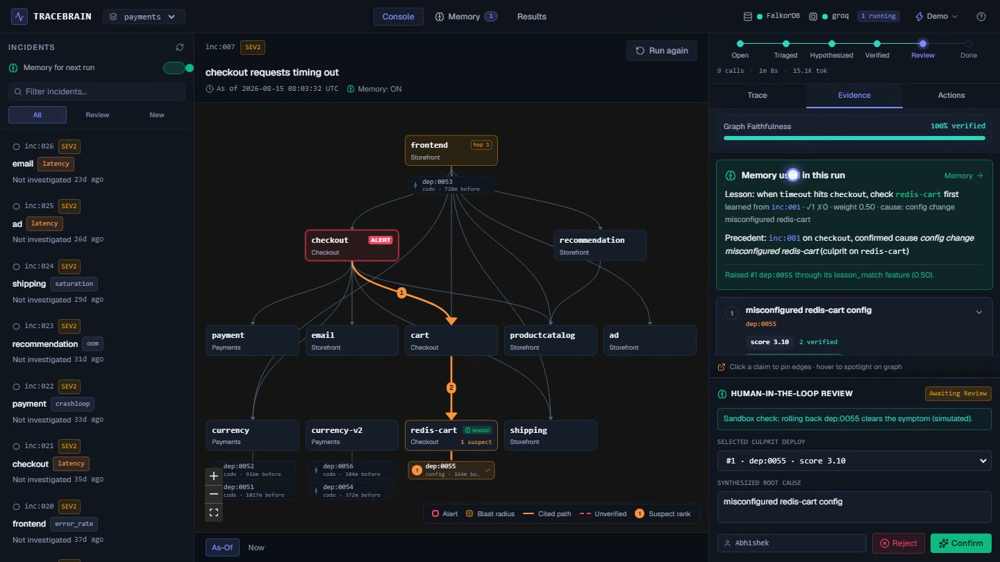
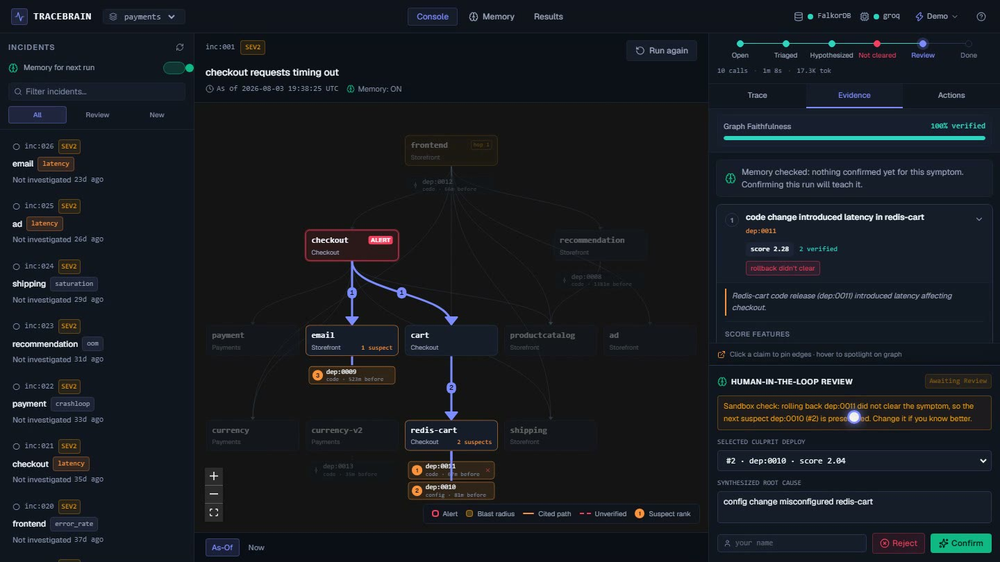
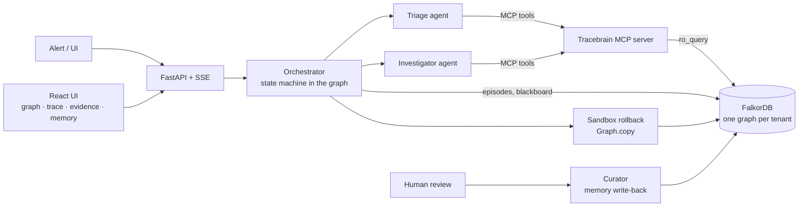
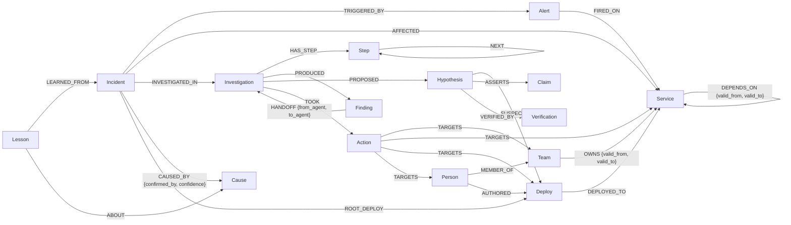
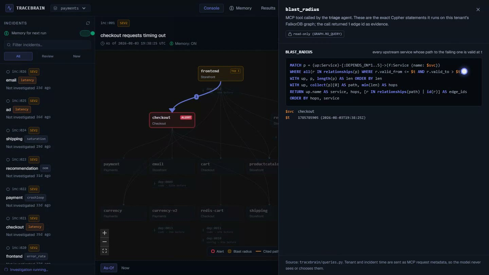

# Tracebrain

**Incident root-cause agents on a FalkorDB temporal graph. Every answer is a path you can check.**

> **Graph Hacks: Context for AI Agents** (WeMakeDevs × FalkorDB, Oct 15–18 2026)
> **Tracks:** Track 01, *Agents That Act on Connected Data* · Track 02, *Agent Memory and Coordination*
> **Demo video (2 min):** [https://www.youtube.com/watch?v=kW73gVgkJoY](https://www.youtube.com/watch?v=kW73gVgkJoY) · **Run it:** [one command](#run-it-in-5-minutes) · **Results:** [eval/results.json](eval/results.json)

[](https://www.youtube.com/watch?v=kW73gVgkJoY)

▶ **[Watch the 2-minute demo on YouTube](https://www.youtube.com/watch?v=kW73gVgkJoY)**: real agents (Groq) on a live FalkorDB graph, from alert to verified root cause to memory.

---

## In 30 seconds

**The problem.** When production breaks, the question is "which change caused this?" The answer depends on connections: which services depend on the failing one, what was deployed on them recently, who owns them, and what fixed this last time. And it depends on *time*: dependencies and owners change, so today's topology can give the wrong answer about yesterday's incident.

**What Tracebrain does.** Two AI agents investigate an incident by **calling graph tools over MCP** on a FalkorDB graph that is rebuilt *as it was when the alert fired*. They rank suspect deploys, propose actions, and every claim they make must cite graph edges they actually retrieved, or it is rejected. A human confirms the answer, and only then does it become **memory** that the next investigation recalls from the graph.

**Why it matters.**
- **Traceable:** every claim → exact edges → highlighted path on the graph → the Cypher that produced it.
- **Honest:** wrong picks get caught (a sandbox rollback check on a copy of the graph). If there is no evidence, the agent abstains instead of guessing.
- **Learns safely:** memory is written only from human-confirmed outcomes, and it measurably improves the next answer (top-1 **22 → 30** of 48 incidents).

### How it works, in order

```
Alert fires on a service at time t
  │
  ├─ 1. Graph "as of t"        every DEPENDS_ON / OWNS edge filtered to valid_from <= t < valid_to
  ├─ 2. Triage agent (MCP)     blast radius · who to page (betweenness) · owners then · similar past incidents
  │                            → writes Finding nodes → HANDOFF edge
  ├─ 3. Investigator (MCP)     reads the findings · recalls lessons · ranks suspect deploys (scored, with paths)
  ├─ 4. Evidence gate          every claim must cite edge ids this run retrieved, and they must match the claim
  ├─ 5. Actions                ticket to the owner then · rollback proposal · page chosen by the algorithm
  ├─ 6. Sandbox check          the rollback is tried on Graph.copy(); the reviewer sees what would be blamed next
  └─ 7. Human review           confirm → Cause + Lesson written to the graph → recalled by the next investigation
```

### For judges: the 3-minute path

1. **Watch** the [2-minute video](https://www.youtube.com/watch?v=kW73gVgkJoY).
2. **Skim** [How it fits the tracks](#how-it-fits-the-tracks): every focus point of Tracks 01 and 02, with the file that implements it.
3. **Check the numbers** without an API key: `uv run pytest -q` (65 tests against a real FalkorDB) and `uv run python eval/run.py` (the [results table](#results-graph-vs-no-graph)).
4. **Read the reasoning** in [The Cypher the product depends on](#the-cypher-the-product-depends-on).

### Submission checklist

| Required by the rules | Where |
|---|---|
| Public source code | This repository, MIT licence. All 24 commits are from Oct 15–18 2026 |
| README with setup and graph data model | [Run it in 5 minutes](#run-it-in-5-minutes) · [Graph data model](#graph-data-model) |
| Cypher queries and graph algorithms used | [The Cypher the product depends on](#the-cypher-the-product-depends-on) · all ~55 statements in [`queries.py`](tracebrain/queries.py) |
| Demo video | [YouTube, 2 min](https://www.youtube.com/watch?v=kW73gVgkJoY) |
| Live deployment or complete local setup | Local setup: one PowerShell command on Windows, or 7 commands with Docker, uv and Node |
| Tracks entered | **Track 01** Agents That Act on Connected Data · **Track 02** Agent Memory and Coordination |
| AI assistance disclosed | [AI assistance disclosure](#ai-assistance-disclosure) |

---

## What a judge should look at

| You want to see… | Where | What to look for |
|---|---|---|
| The graph doing real work | Console → run `inc:001` → **Trace** tab → hover a tool call | Its edges light up on the graph, numbered by hop from the alert |
| The actual queries | **Cypher** button on any trace step | The exact Cypher that MCP tool ran, with its parameters (generated from [`queries.py`](tracebrain/queries.py)) |
| Decisions you can trace | **Evidence** tab → hover a claim | The claim's path on the graph; "100% verified" means every cited edge passed the gate |
| Honesty when the agent is wrong | Evidence + review box after `inc:001` | "rollback didn't clear" on #1, and the next suspect preselected for review |
| Memory written and reused | Confirm `inc:001` → **Memory** page → run `inc:007` | A lesson linked to `inc:001`; on `inc:007` the "Memory used in this run" callout and the 🧠 badge on `redis-cart` |
| Agents coordinating | Trace tab | The triage → investigator **handoff** through `Finding` nodes in the graph |
| Proof the graph is necessary | [Results](#results-graph-vs-no-graph) or the **Results** page | Graph vs no-graph baselines, time-aware vs time-blind, memory on vs off |

---

## One investigation, step by step

This is a real run (Groq `gpt-oss-120b`, live FalkorDB) on `inc:001`, "checkout requests timing out".

1. **The graph as of the incident.** Tracebrain reads the dependency graph with every edge filtered to `valid_from <= t < valid_to`, so it never reasons over today's topology.
2. **Triage agent.** It calls `blast_radius` (multi-hop upstream traversal), `page_priority` (betweenness on the graph as of the incident), `owners_of` (the owning team *at that time*) and `recall_similar` (confirmed past incidents) over **MCP**. It writes its findings as `Finding` nodes and hands off with a `HANDOFF` edge.
3. **Investigator agent.** It reads the findings from the graph and calls `suspects`: every deploy within 3 hops of `checkout` in the 24h window, each with its path edge ids and an explicit score (proximity, recency, change size, failure history, PageRank centrality, lessons).
4. **Evidence gate.** The agent submits 3 hypotheses. Every claim cites edge ids, and the gate checks that each edge was returned by a tool in this run, exists in the graph, and is about what the claim says. Failures are sent back to the agent to fix.
5. **Act, then check.** It proposes a ticket to the owning team and a rollback of #1. **Who gets paged is decided by a graph algorithm, not the LLM**: the owner of the service with the highest betweenness in the blast radius (the chokepoint most traffic flows through). This was added after the video was recorded. The rollback is tried on a **copy of the graph** (`Graph.copy`): the suspects are re-ranked without that deploy.
6. **The catch.** The agent's #1 was a newer code change on `redis-cart`. Rolling it back **did not clear** the symptom, so the review box preselected the sandbox's next suspect, a config change on `redis-cart`: the injected culprit.
7. **Human confirms → memory.** Confirming writes a `Cause` and a `Lesson` ("for timeout on checkout, check redis-cart first") linked to the incident.
8. **Next time.** On `inc:007` (same symptom, later), both agents recall that lesson and the precedent from the graph. The right deploy ranks #1 and its rollback check clears.



---

## Why the graph is doing the work

Remove FalkorDB and nothing runs. Every tool, the agents' shared state and all memory are graph reads and writes. More importantly, the graph changes the answers. From [`eval/run.py`](eval/run.py) over 48 incidents with a known culprit:

| Question | Graph operation | Without it |
|---|---|---|
| Which deploys could have caused this? | As-of `DEPENDS_ON*0..3` closure → `DEPLOYED_TO` → `AUTHORED` | Picking the latest or largest deploy finds the culprit first in only **4–13** of 48; the graph does in **22** |
| What did the system look like then? | Every edge on every path filtered by `valid_from/valid_to` | A time-blind graph ranks the culprit **lower in 10/48** and names the **wrong owner in 8** |
| Is this claim true? | `id(r) IN $ids` lookup of every cited edge | No way to check an LLM's explanation |
| Have we seen this before? | `Incident -CAUSED_BY-> Cause`, `Lesson -LEARNED_FROM-> Incident`, filtered to before `t` | No memory: **22** vs **30** top-1 with it |
| Who should act? | As-of `Team -OWNS-> Service` + `MEMBER_OF` | Tickets and pages go to the old team after an ownership transfer |

The returned **path is the explanation**: the same edge ids the query returns are what the agent must cite, what the gate checks, and what the UI highlights.

---

## Results: graph vs no graph

From `uv run python eval/run.py`. It is deterministic, makes no LLM calls, and writes [`eval/results.json`](eval/results.json) (also shown on the UI's Results page). It scores the suspect ranking the Investigator receives on 52 synthetic incidents in 2 tenants: 48 with a culprit deploy and 4 with none. MRR (mean reciprocal rank) is higher when the culprit sits nearer the top.

| Method (48 incidents with a culprit) | Top-1 | Top-3 | MRR | Culprit never ranked |
|---|---|---|---|---|
| Latest deploy anywhere (no graph) | 7 | 44 | 0.50 | 0 |
| Latest deploy on the alerted service (no graph) | 13 | 24 | 0.39 | 24 |
| Largest change in window (no graph) | 4 | 23 | 0.35 | 0 |
| Graph, time-blind (ignores `valid_from/valid_to`) | 19 | 44 | 0.64 | 0 |
| **Graph, as of the incident** (memory off) | **22** | **47** | **0.69** | 0 |
| **Graph, as of the incident + memory** | **30** | **48** | **0.80** | 0 |

- **Memory:** on repeat incidents (36), top-1 goes from **17 → 25** and MRR from 0.70 → 0.83.
- **Time-awareness:** a time-blind graph ranks the culprit lower in **10/48** incidents (never higher), puts a deploy on a service that isn't called at that time first in 5, and returns the wrong owning team in **8**.
- **Abstention:** all 4 no-deploy incidents get an empty suspect list, so the agent abstains.

---

## How it fits the tracks

### Track 01: Agents That Act on Connected Data

| Judging focus | Tracebrain | Where |
|---|---|---|
| Multi-hop reasoning | As-of blast radius (`DEPENDS_ON*1..5`) and suspect closure (`*0..3` → deploy → author) | [`queries.py`](tracebrain/queries.py) `BLAST_RADIUS`, `SUSPECTS` |
| Graph queries/algorithms as agent tools | 12 MCP tools wrap Cypher and `algo.pageRank` / `algo.betweenness`. `page_priority` runs `algo.betweenness` on a **time-sliced copy** of the graph (`GRAPH.COPY`, then delete every edge not valid at the incident time), so the algorithm sees the topology as it was | [`tools/impl.py`](tracebrain/tools/impl.py) `page_priority` |
| Tool selection through MCP | Agents pick from per-agent allowlists of MCP tools; tenant and time travel as hidden MCP metadata | [`agents/loop.py`](tracebrain/agents/loop.py), [`orchestrator.py`](tracebrain/orchestrator.py) |
| Actions based on the graph | Ticket to the owning team (as of then) and rollback proposal (rollback tried on `Graph.copy`). The **page is chosen by betweenness**: in 9 of 26 incidents per tenant it goes to the owner of an upstream chokepoint, not the alerted service (e.g. `payment` fails → page Checkout, who own `checkout`). Stored as `Action -TARGETS->` nodes | [`orchestrator.py`](tracebrain/orchestrator.py) `_page_action`, [`verification.py`](tracebrain/verification.py) |
| Explainable results | Claim → edge ids → gate → highlighted, hop-numbered path → "Show Cypher" | [`faithfulness.py`](tracebrain/faithfulness.py), UI Evidence/Trace |

### Track 02: Agent Memory and Coordination

| Judging focus | Tracebrain | Where |
|---|---|---|
| Episodic memory | Every investigation is stored as `Investigation -HAS_STEP-> Step -NEXT-> Step` (every tool call, its result and edge ids) | [`memory/episodic.py`](tracebrain/memory/episodic.py) |
| Semantic memory | `Cause` nodes with entity resolution ("db timeout" = "Database timeouts"), confidence, retraction | [`memory/semantic.py`](tracebrain/memory/semantic.py) |
| Procedural memory | `Lesson` "for symptom X on service Y, check Z first", with success/fail counts; it boosts the right suspect next time | [`memory/procedural.py`](tracebrain/memory/procedural.py) |
| Memory that updates | Written only on human confirm; reject weakens it and can retract it | [`agents/curator.py`](tracebrain/agents/curator.py) |
| Shared state and handoffs | Agents share state only through the graph: `Finding` nodes plus a `HANDOFF` edge | `ADD_FINDING`, `HANDOFF` in `queries.py` |
| Persistent history across sessions | The state machine lives in the graph: kill the server mid-run, `POST …/resume` continues and replays finished tool calls from `Step` nodes | [`orchestrator.py`](tracebrain/orchestrator.py), tests in `tests/test_resume_verify.py` |
| Separate memory per tenant | One FalkorDB graph per tenant (`tenant_payments`, `tenant_platform`); the LLM can't see or choose the tenant | `db.py`, `test_mcp_tenant_isolation` |
| High-concurrency reads/writes | 20 investigations run at once across both tenants, then all 20 human confirmations at once: every step chain, finding, hypothesis and memory counter stays intact and in its own tenant. The test found a lost update (10 concurrent confirms counted as 5); memory counters are now updated atomically in Cypher | [`tests/test_concurrency.py`](tests/test_concurrency.py) |

---

## Run it in 5 minutes

**Prerequisites:** Docker, [uv](https://docs.astral.sh/uv/), Node 20+. A free [Groq API key](https://console.groq.com/keys) is needed only for live agent runs; the tests and the eval need none.

```bash
git clone https://github.com/abhishekkamble12/Tracebrain.git && cd Tracebrain
cp .env.example .env                       # add GROQ_API_KEY; change FALKOR_PORT if 6379 is taken
docker compose up -d                       # FalkorDB (+ FalkorDB Browser on :3000)
uv sync
uv run python -m tracebrain.seed --reset   # 2 tenants, 52 synthetic incidents
uv run uvicorn tracebrain.api.main:app --port 8000      # API, docs at http://localhost:8000/docs
cd ui && npm install && npm run dev        # UI at http://localhost:5173
```

**Windows (PowerShell):** one command starts FalkorDB, seeds if needed, and opens the API (:8010) and UI (:5180):
```powershell
copy .env.example .env      # then add GROQ_API_KEY
uv sync
powershell -ExecutionPolicy Bypass -File scripts/run-local.ps1      # add -Reset for fresh data and empty memory
```

**The demo path** (also under the **Demo** menu in the top bar):
1. `inc:001` → **Investigate**. Watch the trace stream and the edges light up. Open **Cypher** on a step.
2. **Evidence**: hover the claims. If #1 says "rollback didn't clear", the review box already preselects the next suspect. **Confirm**.
3. **Memory** page: the new lesson, linked to `inc:001`.
4. `inc:007` (memory ON) → **Investigate**. Look for "Memory used in this run" and the 🧠 badge on `redis-cart`.
5. `inc:025`: nothing was deployed on its dependencies, so the agent abstains.

**Check it without an API key:**
```bash
uv run pytest -q              # 65 tests against a real FalkorDB (they skip if it isn't running)
uv run python eval/run.py     # the results table above, no LLM calls
```

If 6379 or 3000 is already used on your machine (e.g. by another Redis), set `FALKOR_PORT` / `FALKOR_BROWSER_PORT` in `.env`. Compose and the app both read them. Pointing Tracebrain at a plain Redis fails with a clear "without the FalkorDB graph module" message.

---

## Architecture



- **Agents:** Groq free tier (`openai/gpt-oss-120b`) through an OpenAI-compatible API, each with its own tool allowlist.
- **Read-only by construction:** agent reads go through FalkorDB `ro_query`, so the agents can't change the world graph. Their only write is `write_finding` on their own investigation.
- **Hidden context:** tenant and incident time are MCP request metadata, never tool arguments, so the model can neither see nor change them.
- **Live UI:** the API streams every step over SSE. The UI draws the as-of graph (React Flow), lights each tool call's edges, and shows the exact Cypher per step.

## Graph data model



| Layer | Nodes | Written by |
|---|---|---|
| World (temporal) | Service, Team, Person, Deploy, Alert, Incident | ingestion ([`ingest.py`](tracebrain/ingest.py), idempotent `MERGE`) |
| Episodic memory + blackboard | Investigation, Step, Finding, Hypothesis, Claim, Action, Verification | orchestrator; agents only via `write_finding` |
| Semantic memory | Cause (`aliases`, `confidence`, `retracted`) | curator, after a human review |
| Procedural memory | Lesson (`symptom`, `service`, `check_first`, `success_count`, `fail_count`, `retracted`) | curator, after a human review |

Time is epoch seconds. A temporal edge is live at `t` when `valid_from <= t < valid_to`. Open-ended edges use `valid_to = 4102444800` (year 2100), so queries never test for null.

## The Cypher the product depends on

All of it lives in [`tracebrain/queries.py`](tracebrain/queries.py) (about 55 named statements). The UI's **Show Cypher** drawer is generated from that file, and a test fails if they drift apart. These are the ones that do the reasoning.

**Blast radius as of the incident:** multi-hop, every edge on the path valid at `t`.
```cypher
MATCH p = (up:Service)-[:DEPENDS_ON*1..5]->(f:Service {name: $svc})
WHERE all(r IN relationships(p) WHERE r.valid_from <= $t AND r.valid_to > $t)
WITH up, p, length(p) AS len ORDER BY len
WITH up, collect(p)[0] AS path, min(len) AS hops
RETURN up.name AS service, hops, [r IN relationships(path) | id(r)] AS edge_ids
ORDER BY hops, service
```

**Suspect deploys:** the as-of dependency closure, then deploys in the window, then authors. The returned `edge_ids` are the evidence the agent must cite.
```cypher
MATCH p = (f:Service {name: $svc})-[:DEPENDS_ON*0..3]->(s:Service)
WHERE all(r IN relationships(p) WHERE r.valid_from <= $t AND r.valid_to > $t)
WITH s, p, length(p) AS len ORDER BY len
WITH s, collect(p)[0] AS path, min(len) AS proximity
MATCH (d:Deploy)-[dr:DEPLOYED_TO]->(s)
WHERE d.ts <= $t AND d.ts >= $t - $window AND NOT coalesce(d.rolled_back, false)
OPTIONAL MATCH (a:Person)-[:AUTHORED]->(d)
RETURN d.id AS deploy, s.name AS service, s.service_type AS service_type, d.ts AS ts,
       d.change_size AS change_size, d.kind AS kind, d.summary AS summary, a.handle AS author,
       proximity, [r IN relationships(path) | id(r)] + [id(dr)] AS edge_ids
ORDER BY proximity, ts DESC
```
Suspects are then scored with explicit features (`proximity`, `recency`, `change_size`, `fail_rate`, `centrality` from PageRank, `lesson_match` from memory). See [`scoring.py`](tracebrain/scoring.py).

**Owners as of the incident:**
```cypher
MATCH (t:Team)-[r:OWNS]->(s:Service)
WHERE s.name IN $services AND r.valid_from <= $t AND r.valid_to > $t
OPTIONAL MATCH (p:Person)-[:MEMBER_OF]->(t)
RETURN s.name AS service, t.name AS team, collect(p.handle) AS people, id(r) AS edge_id
```

**Shortest dependency path as of `t`** (var-length + filter, because `shortestPath()` ignores edge properties; see below):
```cypher
MATCH p = (a:Service {name: $a})-[:DEPENDS_ON*1..6]->(b:Service {name: $b})
WHERE all(r IN relationships(p) WHERE r.valid_from <= $t AND r.valid_to > $t)
WITH p, length(p) AS len ORDER BY len LIMIT 1
RETURN [n IN nodes(p) | n.name] AS services, [r IN relationships(p) | id(r)] AS edge_ids
```

**Graph algorithms.** FalkorDB's `algo.*` can't filter on edge properties. In `suspects`, PageRank over all edges is a small structural prior. `page_priority` makes them time-aware instead: it copies the graph, deletes the edges not valid at `$t`, and runs the algorithms on the copy (cached per distinct as-of topology):
```cypher
CALL algo.pageRank('Service', 'DEPENDS_ON') YIELD node, score RETURN node.name AS service, score
CALL algo.betweenness({nodeLabels: ['Service'], relationshipTypes: ['DEPENDS_ON']}) YIELD node, score RETURN node.name, score
// page_priority, on a GRAPH.COPY of the tenant graph, before the two calls above:
MATCH ()-[r:DEPENDS_ON]->() WHERE NOT (r.valid_from <= $t AND r.valid_to > $t) DELETE r
```

**Evidence gate:** resolve every cited edge id and check it against the claim.
```cypher
MATCH (a)-[r]->(b) WHERE id(r) IN $ids
RETURN id(r) AS id, type(r) AS type, coalesce(a.name, a.handle, a.id) AS src, coalesce(b.name, b.handle, b.id) AS dst
```

**Memory recall:** lessons and confirmed precedents, strictly from *before* the incident.
```cypher
MATCH (l:Lesson {symptom: $symptom, service: $service})-[:LEARNED_FROM]->(i:Incident)
WHERE NOT l.retracted AND i.ts < $t
WITH l, collect(i.id) AS evidence
OPTIONAL MATCH (l)-[:ABOUT]->(c:Cause)
RETURN l.id AS id, l.check_first AS check_first, l.success_count AS success_count, l.fail_count AS fail_count, c.name AS cause, evidence
ORDER BY success_count - fail_count DESC LIMIT 5
```
```cypher
// RECALL_SIMILAR, abbreviated (full version in queries.py)
MATCH (i:Incident)-[cb:CAUSED_BY]->(c:Cause)
WHERE i.ts < $t AND i.symptom = $symptom AND NOT c.retracted
MATCH (i)-[:AFFECTED]->(s:Service)
OPTIONAL MATCH (i)-[:ROOT_DEPLOY]->(d:Deploy)-[:DEPLOYED_TO]->(ds:Service)
RETURN i.id AS incident, s.name AS service, c.name AS cause, ds.name AS culprit_service, d.kind AS culprit_kind
```

**Agent handoff on the blackboard:**
```cypher
MATCH (v:Investigation {id: $id})-[:PRODUCED]->(f:Finding {agent: $from_agent})
CREATE (f)-[:HANDOFF {from_agent: $from_agent, to_agent: $to_agent, ts: $now}]->(v)
```



### FalkorDB findings that shaped the design

These were checked against a running server with [`scripts/capability_check.py`](scripts/capability_check.py); the output is in [`docs/falkordb_capabilities.md`](docs/falkordb_capabilities.md).
- `shortestPath()` is only allowed in `WITH`/`RETURN`, and it **ignores edge properties**: at t=50 it returned a path through a dependency that didn't exist yet. So all time-critical paths use var-length + an `all()` as-of filter.
- `algo.pageRank`, `algo.betweenness`, `algo.BFS`, `algo.WCC` and `algo.labelPropagation` all work, but none filter on edge properties. So they are either time-agnostic priors (`suspects`) or run on a time-sliced `Graph.copy()` (`page_priority`).
- `ro_query` rejects writes, which enforces read-only agents for free.
- `Graph.copy()` gives a cheap sandbox for "what if we roll this back?".

## MCP tools

Server: [`tracebrain/tools/mcp_server.py`](tracebrain/tools/mcp_server.py). It runs over stdio, or streamable HTTP with `--http` (`uv run python -m tracebrain.tools.mcp_server --http`), so any MCP client can use it.

| Tool | Graph work | Used by |
|---|---|---|
| `blast_radius` | as-of multi-hop `DEPENDS_ON*1..5` | Triage |
| `owners_of` | as-of `OWNS` + `MEMBER_OF` | Triage, Investigator |
| `suspects` | as-of closure → deploys → authors, PageRank, lessons | Investigator |
| `path_between` | as-of shortest path | Investigator |
| `page_priority` | `algo.betweenness` + `algo.pageRank` on an as-of `Graph.copy`, over the blast radius, + as-of owners: **picks who is paged** | Triage |
| `centrality` | `algo.pageRank`, `algo.betweenness` (all edges ever seen) | Investigator |
| `write_finding` / `read_findings` | blackboard nodes | Triage / Investigator |
| `recall_similar`, `recall_lessons`, `get_past_investigation` | memory subgraph | both |
| `get_incident` | incident lookup | external clients |

## Data

All data is **synthetic**, from a seeded, deterministic generator ([`connectors/synthetic.py`](tracebrain/connectors/synthetic.py)). It is an Online Boutique-shaped system: 12 services, 18 dependency edges, 3 timeline changes (a `currency` → `currency-v2` migration, an ownership transfer, a new dependency), about 230 deploys and 26 incidents per tenant. Each incident has an injected culprit plus decoys: newer deploys on callers, other deploys on the dependency path, and stale deploys on dependencies that aren't live at incident time. The ground truth (`data/ground_truth.json`) is never shown to the agents, and a leakage check makes sure no agent-visible text hints at the cause. Names are fictional. No private or personal data is used.

## Design decisions (and why)

**Why rebuild the graph "as of" the incident?** Dependencies and owners change. A time-blind graph ranks the real culprit lower in 10 of 48 incidents and names the wrong owning team in 8. Every temporal edge carries `valid_from`/`valid_to`, and every path query filters on it.

**Why must claims cite edge ids?** An LLM's explanation is otherwise unverifiable. Making the agent cite the exact edges its tools returned turns "the model says so" into a path a human can check. The gate rejects fabricated or irrelevant edges and sends the problems back to the agent.

**Why is the suspect ranking deterministic, with the LLM reasoning over it?** Reproducibility and a fair eval. The ranking can be measured against ground truth without LLM noise. The LLM adds judgement on top: re-ranking with a lesson or a precedent, writing the claims, choosing actions.

**Why does only a human confirmation write memory?** A wrong lesson would bias every later investigation. So Causes and Lessons are written only on a human confirm, a reject weakens them, and they can be retracted. Memory is also only recalled from incidents *before* the current one, so it never leaks the answer.

**Why do agents share state through the graph and not through messages?** The handoff is then durable and inspectable: a restarted server resumes from the `Step` and `Finding` nodes, and the UI shows exactly what triage handed over.

**Why run graph algorithms on a copy?** FalkorDB's `algo.*` can't filter edges by validity. Copying the graph, deleting the edges that weren't live at `t` and running betweenness there gives a time-correct ranking without touching the live graph.

## What's next

- Real connectors (PagerDuty, GitHub deploys, service catalogues) behind the existing [`connectors/base.py`](tracebrain/connectors/base.py) protocol.
- A real rollback environment (revert in staging, watch metrics) in place of the oracle.
- Letting agents run in parallel on one incident (e.g. one per suspect service), coordinated through the same blackboard.
- Executing approved actions (open the ticket, send the page) after human review.

## Limitations (honest)

- **The rollback's "does the symptom clear?" answer is an oracle.** The sandbox part is real graph work (`Graph.copy`, mark rolled back, re-rank), but whether the symptom clears comes from the synthetic ground truth, labelled "simulated oracle" wherever it appears. It never re-ranks hypotheses and isn't part of the eval. A real deployment would revert in staging and watch metrics.
- **Small, synthetic graph.** As-of vs time-blind never changes the blast radius in this dataset; the effect shows up in suspects and owners.
- **In the suspect ranking, graph algorithms are a small time-agnostic prior** (PageRank is weight 0.2 of 7.0). Betweenness drives the page decision, and there it runs on the as-of graph, but in this small dataset the as-of and time-blind betweenness choose the same service in all but 1 of 26 incidents per tenant.
- **The ranking is deterministic and the LLM reasons over it.** That's intentional, for reproducibility, but the eval measures the ranking, not the LLM's final pick.
- The evidence gate's relevance check is a heuristic (a cited edge must touch a node named in the claim). The Curator is deterministic code triggered by a human review, not an LLM agent.

## Repository layout

```
tracebrain/
  queries.py        every Cypher statement
  db.py, schema.py  FalkorDB client, one graph per tenant, indexes
  connectors/       synthetic world generator (+ connector protocol)
  ingest.py, seed.py
  tools/            impl.py (tool functions), mcp_server.py (MCP server)
  agents/           loop.py (LLM <-> MCP), prompts.py, curator.py, smoke.py
  memory/           episodic.py, semantic.py, procedural.py
  scoring.py        suspect features + weights
  faithfulness.py   evidence gate
  verification.py   sandbox rollback check
  orchestrator.py   resumable state machine
  api/main.py       FastAPI + SSE
eval/run.py         deterministic evaluation -> eval/results.json
ui/                 React + Vite + React Flow console
scripts/            run-local.ps1, capability_check.py, export_cypher_for_ui.py
tests/              65 tests against a real FalkorDB
```

## AI assistance disclosure

AI coding assistants were used during this hackathon, including **Claude Code (Anthropic)**. They were used to:
- draft planning documents (`PLAN.md`, `IMPLEMENTATION.md`, `docs/FRONTEND_PLAN.md`, `.agents/tasks/plan.md`);
- scaffold boilerplate (FastAPI routes, React components, test fixtures);
- write parts of the evaluation script, the UI polish and this README;
- review the code, including pre-submission audits;
- record the demo footage with a browser-automation script and assemble the video.

The demo video's voiceover is AI text-to-speech (ElevenLabs).

I designed the graph data model (temporal `DEPENDS_ON`/`OWNS` edges, the investigation/blackboard subgraph, Cause/Lesson memory), chose the queries and verified them against a running FalkorDB (`scripts/capability_check.py`), designed the suspect-scoring function and the path-faithfulness gate, and reviewed, ran and tested the code.

At runtime, the agents use Groq-hosted open-weight models (`openai/gpt-oss-120b`, `llama-3.1-8b-instant`).

## License

MIT, see [LICENSE](LICENSE).
